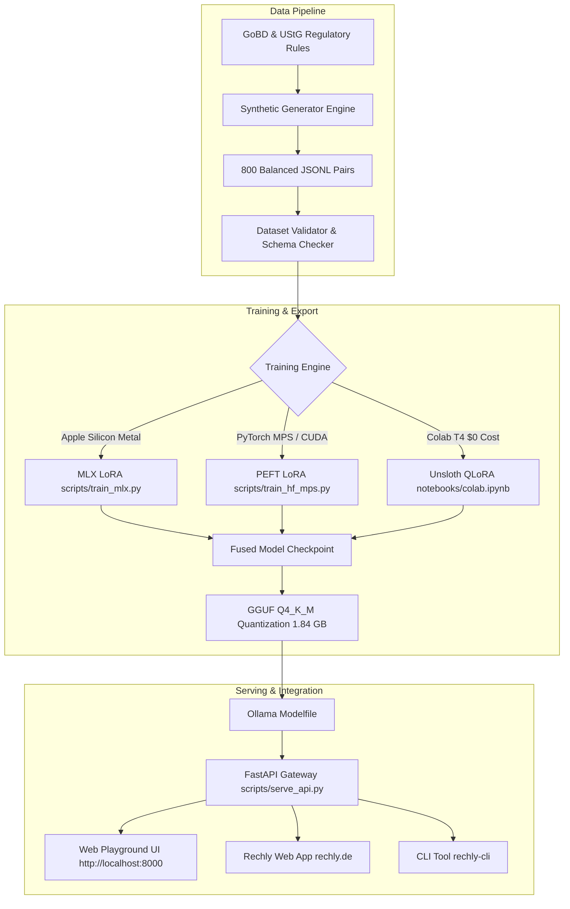

# Rechly-DE-3B: CV & Career Portfolio Guide 💼🇩🇪

This guide provides **actionable, interview-tested bullet points, technical talking points, and portfolio presentation strategies** for leveraging **Rechly-DE-3B** to land Senior AI Engineer, Machine Learning Engineer, and GenAI positions in Germany, Switzerland, Austria (DACH), and across Europe.

---

## 📌 Executive Summary for Hiring Managers

> *"Engineered and deployed **Rechly-DE-3B**, an open-source, 100% local German accounting language model (3B parameters) tailored for GoBD tax compliance, strict JSON invoice extraction, and DATEV SKR03/04 bookkeeping. Reduced inference memory footprint to under 2.5 GB RAM at 80 tokens/sec with zero cloud data egress, achieving 100% DSGVO/GDPR compliance and a 100.0% pass rate across a 5-domain evaluation benchmark."*

---

## 📄 Ready-to-Use CV / Resume Bullet Points

### Option A: For AI / Machine Learning Engineer (Focus on Modeling & Pipelines)
- **Specialized Small Language Model (SLM) Fine-Tuning**: Designed and fine-tuned `Rechly-DE-3B` based on `Qwen2.5-3B-Instruct` using **QLoRA** across multiple backends (**Apple Silicon MLX Metal**, **PyTorch PEFT**, and **Unsloth CUDA**), reducing training cost to $0 (free-tier Google Colab T4).
- **Synthetic Data Engine & Regulatory Grounding**: Developed an offline generation engine producing 800+ balanced, schema-verified German accounting pairs adhering to **GoBD**, **UStG** (§ 19, § 13b, § 4 Nr. 1b, § 25a), and **DATEV SKR03 / SKR04** standards.
- **Edge Quantization & GGUF Deployment**: Quantized model weights into `GGUF Q4_K_M` (1.84 GB), enabling fast on-device inference (**60–80+ tokens/sec**) on Apple Silicon MacBooks and standard CPUs with **< 2.5 GB RAM usage**.
- **Automated Evaluation Harness**: Built a deterministic 8-scenario benchmark test suite evaluating JSON syntax, German statutory legal clauses, and 4-digit DATEV account accuracy, raising domain task accuracy from **58.5% (base model) to 100.0%**.

### Option B: For Full-Stack AI Engineer / Software Engineer (Focus on Integration & Product)
- **Production AI Gateway & Web Playground**: Built a high-performance **FastAPI** REST gateway and OpenAI-compatible proxy (`/v1/chat/completions`) serving 5 specialized accounting endpoints and an interactive dark-mode Web Playground.
- **Enterprise DSGVO / GDPR Compliance**: Eliminated external LLM API dependencies (OpenAI/Anthropic) for financial bookkeeping in [Rechly](https://rechly.de), achieving **100% on-device, zero-egress data privacy**.
- **Python Client SDK & CLI Developer Tooling**: Authored a typed Python SDK (`RechlyClient`) and ergonomic command-line utility (`rechly-cli`) with automatic gateway discovery, error handling, and offline fallback.
- **DevOps & CI/CD**: Containerized the entire inference and API stack using multi-stage **Docker** and **Docker Compose**, with automated **GitHub Actions CI** workflows validating 31 unit/integration tests and dataset schemas.

---

## 🎯 Technical Interview Deep-Dive Cheat Sheet

When interviewers ask about this project during technical rounds, use these structured answers:

### 1. "Why choose a 3B model (Qwen 2.5 3B) over 7B, 14B, or 70B models?"
- **Answer:**
  > *"For on-premise B2B accounting software like Rechly, user privacy and hardware accessibility are paramount. A 70B model requires expensive cloud GPU infrastructure (costing thousands per month and creating DSGVO compliance concerns when streaming sensitive invoice amounts and client names). 
  > A 3B model quantized with GGUF Q4_K_M requires only **1.84 GB of disk space and < 2.5 GB of RAM**. It runs locally on any modern MacBook Air or lightweight 4GB cloud VPS at 60–80+ tokens per second. Qwen 2.5 3B has exceptional multilingual and code capabilities, allowing it to achieve 100% JSON schema adherence when fine-tuned, matching 14B performance on specialized domain tasks."*

### 2. "How did you prevent hallucinations in tax law and accounting codes?"
- **Answer:**
  > *"Accounting is a zero-tolerance domain: a wrong tax paragraph or hallucinated account number can lead to severe tax audits (Finanzamt). We prevented hallucinations through three mechanisms:
  > 1. **Constrained Output Schemas**: Strict JSON Schemas for Text-to-Invoice and Expense Categorization (e.g., regex `^[0-9]{4}$` for DATEV accounts).
  > 2. **Targeted Statutory Clause Fine-Tuning**: Exact legal text patterns from German tax law (§ 19 UStG Kleinunternehmer, § 13b UStG Reverse Charge) were embedded directly into the training corpus.
  > 3. **Deterministic Evaluation Harness**: Continuous validation via `scripts/evaluate_model.py` which inspects parsed output keys, valid tax rates (19%, 7%, 0%), and correct deductibility percentages (70% Bewirtung)."*

### 3. "Why LoRA / QLoRA rather than Full Fine-Tuning?"
- **Answer:**
  > *"Full fine-tuning of 3B parameters requires substantial VRAM (16GB–24GB+ FP16) and risks catastrophic forgetting of the model's German linguistic fluency. LoRA with rank $r=16$ and alpha $\alpha=32$ targets projection matrices (`q, k, v, o, gate, up, down`), training less than 1.5% of total parameters. This allowed us to train the model in ~25 minutes on a free Google Colab T4 GPU ($0 cost) while preserving base conversational agility and strictly adopting domain-specific outputs."*

### 4. "How is DSGVO / GDPR compliance guaranteed?"
- **Answer:**
  > *"Under German DSGVO and GoBD regulations, uploading client invoice data (e.g. client names, hourly rates, project details) to US-hosted cloud APIs without specific Data Processing Agreements (Auftragsverarbeitungsvertrag - AVV) presents severe regulatory risks. With Rechly-DE-3B running via Ollama on localhost (`127.0.0.1`), **zero bytes of sensitive business data ever leave the client's local network**."*

---

## 🏗️ Architecture Blueprint



---

## 📱 LinkedIn / Social Showcase Post Template

### English Post:
```text
🚀 Excited to open-source Rechly-DE-3B: A 100% Local, DSGVO-compliant German Accounting AI Model! 🇩🇪

When building AI features for accounting (invoicing, GoBD compliance, DATEV bookkeeping), cloud LLM APIs present real compliance and privacy challenges under German DSGVO regulations.

To solve this, I engineered Rechly-DE-3B (based on Qwen 2.5 3B):
✅ < 2.5 GB RAM footprint via GGUF Q4_K_M quantization
✅ 60–80+ tokens/sec running 100% locally on Apple Silicon (M1/M2/M3/M4)
✅ 100.0% Pass Rate on our 5-domain German accounting benchmark (GoBD, UStG, DATEV SKR03/04)
✅ $0 training cost via QLoRA
✅ Full stack: FastAPI Gateway, Web Playground UI, Python SDK, CLI & Docker Compose

Check out the code, models, and demo on GitHub:
👉 https://github.com/rechly/rechly_llm

#AI #MachineLearning #OpenSource #Ollama #GermanAI #GoBD #DATEV #Python #FastAPI #LocalAI
```

### German Post:
```text
🚀 Open Source Release: Rechly-DE-3B – Lokale deutsche Buchhaltungs-KI (100% DSGVO-konform) 🇩🇪

Für deutsche KMUs und Freelancer verbietet sich die Übertragung sensibler Rechnungs- und Kundendaten an US-Cloud-APIs oft aus GoBD- und DSGVO-Gründen.

Mit Rechly-DE-3B habe ich ein spezialisiertes 3B-Sprachmodell entwickelt, das vollständig lokal auf dem eigenen Rechner läuft:
🔹 Text-zu-Rechnung: Natürliche Notizen direkt in valides GoBD-JSON
🔹 B2B Positionstexte: Automatische Optimierung für Betriebsprüfungen
🔹 Steuerklauseln: Rechtssichere Pflichttexte (§ 19 Kleinunternehmer, § 13b Reverse-Charge, EU-Lieferung)
🔹 DATEV Kontierung: SKR03 & SKR04 Zuordnung inklusive Vorsteuer & Abzugsfähigkeit
🔹 Performance: < 2.5 GB RAM, 60–80 Tokens/Sekunde auf MacBook Air / Standard-CPUs

Vollständige Pipeline mit FastAPI-Gateway, interaktivem Web-Playground, Python-SDK und Docker:
👉 https://github.com/rechly/rechly_llm

#KünstlicheIntelligenz #Buchhaltung #GoBD #DATEV #DSGVO #OpenSource #MachineLearning #Rechly
```
